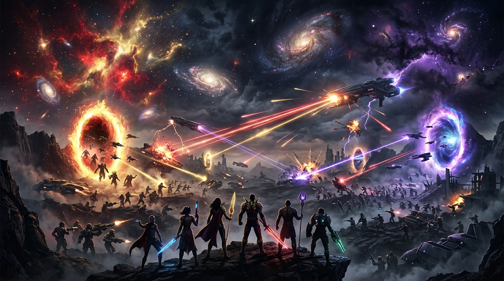

# 🎬 MCU Complete Guide — Road to Avengers: Doomsday

An interactive, cinematic web app for tracking your watch progress across **104 Marvel movies and TV series** — the complete MCU timeline plus legacy franchises — organized by saga and phase. Built with vanilla HTML, CSS, and JavaScript. Zero dependencies, fully offline-capable.



---

## ✨ Features

### Core Experience
- **Watch Progress Tracking** — Mark movies and individual TV episodes as watched. Progress persists automatically via `localStorage`.
- **Dual-View Navigation** — A **Home Hub** with saga/phase cards and an **In-Phase Grid View** with full entry details and sequential phase navigation.
- **Dynamic "Up Next" Hero** — Automatically identifies your next unwatched title and surfaces it in a hero banner with a one-click CTA.
- **Phase Completion Toasts** — Celebratory notifications fire when you 100% a phase.

### Organization & Filtering
- **Saga → Phase → Entry Hierarchy** — Entries grouped into the Infinity Saga (Phases 1–3), Multiverse Saga (Phases 4–6), and Beyond the MCU (legacy franchises).
- **Type Filtering** — Filter by Films, Series, or All.
- **Debounced Live Search** — Real-time title search across all entries.
- **Verdict Badges** — Color-coded priority ratings: 🟢 Must Watch, 🟡 Recommended, 🔵 Optional, 🔴 Skip.

### The Doomsday Fast Track
- A curated **11-title minimum watchlist** with priority rankings and narrative rationale for fans short on time preparing for *Avengers: Doomsday*.
- Displayed as a horizontal-scroll carousel with contextual viewing tips.

### Detail Modal
- Click any entry to open a full-detail overlay with backdrop art, synopsis, year, type, verdict, and a watch toggle.
- **Episode Checklists** — Series entries include per-episode tracking with auto-sync (checking all episodes marks the series as watched).

### Design & Polish
- **Cinematic dark theme** with Marvel Red and IMDb Gold accents.
- **Glassmorphism** depth with backdrop blur and layered surfaces.
- **Micro-animations** — card hover glow, progress bar fills, modal entrances, toast slide-ins, confetti on watch.
- **Fully responsive** — adapts from desktop (5-column grid) down to mobile (2-column) with fluid `clamp()` typography.
- **Accessible** — skip-to-content link, ARIA labels, keyboard navigation, WCAG AA contrast.

---

## 🏗️ Project Structure

```
project-marvel/
├── index.html                  # Entry point — loads fonts, styles, data, and app
├── css/
│   └── styles.css              # Complete design system (dark theme, glassmorphism,
│                               #   animations, responsive breakpoints, component styles)
├── js/
│   ├── mcu_data.js             # All 104 entries + Fast Track + viewing tips as MCU_DATA
│   └── app.js                  # Core application (WatchTracker class, MCUApp class,
│                               #   rendering, filtering, modals, persistence)
├── images/
│   ├── hero_banner.jpg         # Full-width hero background
│   └── phase_[1-6].jpg         # Banner artwork for each phase section
├── data/
│   └── posters.json            # Cached poster URLs fetched from IMDb/Wikipedia
├── scripts/                    # Node.js offline data utilities (not used at runtime)
│   ├── fetch_imdb.js           # Fetches poster URLs via IMDb Suggest API
│   ├── fetch_wiki_posters.js   # Fetches poster URLs via Wikipedia/TMDB APIs
│   └── inject_posters.js       # Injects poster URLs from posters.json into mcu_data.js
└── docs/
    ├── mcu_complete_guide.md   # Full 62-entry MCU reference with synopses and episodes
    └── style_ui_prompt.txt     # Design specification and creative brief for the UI
```

---

## 🔧 How It Works

### Architecture Overview

```
index.html
    ├── Google Fonts (Anton, Bebas Neue, Inter, JetBrains Mono)
    ├── css/styles.css        → Design system & component styles
    ├── js/mcu_data.js        → Global MCU_DATA constant (sagas, phases, entries)
    └── js/app.js             → WatchTracker + MCUApp → renders into <div id="app">
```

The app is a **static, single-page application** with zero runtime dependencies. No build step, no bundler, no frameworks. Everything renders client-side from a self-contained data file.

---

### Data Layer — `js/mcu_data.js`

A global `MCU_DATA` object with three top-level keys:

| Key | Type | Contents |
|---|---|---|
| `sagas` | `Array<Object>` | Hierarchical saga → phase → entry structure |
| `fastTrack` | `Array<Object>` | 11 curated priority entries for the Doomsday prep watchlist |
| `tips` | `Array<string>` | 10 contextual viewing tips and continuity notes |

**Entry schema:**

```javascript
{
  id: 1,                        // Unique ID (1–62 MCU, 100s X-Men, 200s Spider-Man, etc.)
  title: "Iron Man",
  poster: "https://...",        // High-res poster URL (IMDb/TMDB CDN)
  year: "2008",                 // Release year or window (e.g. "Jul 2025")
  type: "film",                 // "film", "series", "animated", or "shorts"
  verdict: "must-watch",        // Priority: "must-watch", "recommended", "optional", "skip", "essential"
  description: "Tony Stark...", // Concise synopsis
  episodes: null,               // null for films; Array<{code, title}> for series
  nonMcu: false                 // true for legacy/non-MCU franchises
}
```

**Coverage — 104 total entries:**

| Saga | Phases/Franchises | Entries | ID Range |
|---|---|---|---|
| **The Infinity Saga** (2008–2019) | Phase 1, 2, 3 | 23 | 1–23 |
| **The Multiverse Saga** (2021–2027) | Phase 4, 5, 6 | 39 | 24–62 |
| **Beyond the MCU** (2000–2024) | Fox X-Men, Spider-Man (Raimi/Webb), Fantastic Four, Netflix Defenders, Sony SSU, Legacy Marvel | 42 | 101–607 |

---

### Application Layer — `js/app.js`

Two core classes:

#### `WatchTracker`
Manages all persistence via `localStorage` (key: `"mcu-tracker"`).

| Method | Purpose |
|---|---|
| `load()` / `save()` | Read/write JSON state from `localStorage` |
| `isWatched(id)` | Check if an entry or episode is watched |
| `toggle(id)` | Flip watch state, delete if false (space-efficient), save |
| `setWatched(id, val)` | Directly set a watch state |
| `getEntryProgress(entryId, episodes)` | Compute `{watched, total}` for series episodes |
| `getOverallStats()` | Aggregate watch counts across all entries/episodes |
| `reset()` | Clear all state |

**Storage format:** A flat object with boolean flags — `"entry-1": true`, `"ep-25-S01E01": true`. Keys are deleted (not set to `false`) to minimize storage size.

#### `MCUApp`
Controls the entire UI lifecycle:

| Method | Purpose |
|---|---|
| `render()` | Master render — switches between Home and Phase views |
| `renderHero()` | "Up Next" hero banner with global progress bar |
| `renderToolbar()` | Sticky nav with logo, filters, search, watch counter |
| `renderHomeView()` | Saga/Phase card grid with progress meters |
| `renderContent()` / `renderPhase()` | Full phase grids with entry cards |
| `renderEntry()` | Individual media card (poster, verdict badge, hover actions) |
| `renderFastTrack()` | Doomsday Fast Track carousel + tips grid |
| `openModal()` / `closeModal()` | Detail overlay with episode checklists |
| `applyFilters()` | Toggle `.hidden` CSS classes (no re-render needed) |
| `navigateToPhase()` / `navigateToHome()` | View transitions with scroll-to-top |
| `showToast()` | Phase completion celebration notifications |

**Rendering approach:** Pure DOM manipulation via template literals and `innerHTML`. No virtual DOM, no framework. Poster fallbacks use deterministic CSS gradients when images are missing.

---

### Styling — `css/styles.css`

| Aspect | Implementation |
|---|---|
| **Theme** | Dark cinematic (`#0b0b0d` base, `#18181b` surfaces, `#2a2a2e` borders) |
| **Accents** | Marvel Red `#ed1d24`, IMDb Gold `#f5c518`, Watched Green `#3ddc84` |
| **Depth** | Glassmorphism (`backdrop-filter: blur()`), layered shadows, glow effects |
| **Layout** | CSS Grid (`auto-fill`, `minmax`) + Flexbox, horizontal scroll-snap carousel |
| **Typography** | Display: Anton / Bebas Neue · Body: Inter · Mono: JetBrains Mono |
| **Animations** | Progress fill, card fade-in, shimmer skeleton, modal scale, toast slide, search expand |
| **Responsive** | Breakpoints at 768px and 480px, `clamp()` fluid type, grid column adaption |

---

## 🛠️ Data Pipeline (Offline Scripts)

The `scripts/` directory contains Node.js utilities for populating poster URLs in the data file. These are **build-time tools only** — the app makes zero network requests at runtime.

```
[Title Lists]
       │
       ▼  (Fetch)
 IMDb Suggest API  /  Wikipedia API  /  TMDB API
       │
       ▼  (Transform)
 Parse responses, filter types, adjust resolution
       │
       ▼  (Output)
 data/posters.json
       │
       ▼  (Inject)
 inject_posters.js → regex match & inject into js/mcu_data.js
```

| Script | API | What It Does |
|---|---|---|
| `fetch_imdb.js` | IMDb Suggest API | Fetches poster CDN URLs, filters by media type, upscales to 600px |
| `fetch_wiki_posters.js` | Wikipedia + TMDB (fallback) | Fetches poster thumbnails via Wikipedia PageImages API |
| `inject_posters.js` | Local filesystem | Reads `posters.json`, regex-injects `poster` fields into `mcu_data.js` |

```bash
# Fetch poster URLs → data/posters.json
node scripts/fetch_imdb.js
# or
node scripts/fetch_wiki_posters.js

# Inject into data file
node scripts/inject_posters.js
```

---

## 🚀 Getting Started

No build step. No `npm install`. No dependencies. Just serve the files.

### Option 1 — Open directly
Double-click `index.html` or open it in your browser.

### Option 2 — Local server (recommended)
```bash
# Python
python -m http.server 8000

# Node.js
npx -y serve .

# PHP
php -S localhost:8000
```

Then visit `http://localhost:8000`.

---

## 📖 Documentation

| File | Purpose |
|---|---|
| [`docs/mcu_complete_guide.md`](docs/mcu_complete_guide.md) | Complete 62-entry MCU reference with synopses, episode listings, and priority ratings |
| [`docs/style_ui_prompt.txt`](docs/style_ui_prompt.txt) | Design specification — color palette, typography, component specs, layout hierarchy, and accessibility requirements |

---

## 🧰 Tech Stack

| Layer | Technology |
|---|---|
| **Markup** | HTML5 with semantic elements and accessibility |
| **Styling** | Vanilla CSS3 — custom properties, Grid, Flexbox, animations, glassmorphism, `clamp()` |
| **Logic** | Vanilla JavaScript — class-based architecture, `localStorage`, zero dependencies |
| **Fonts** | Google Fonts (Anton, Bebas Neue, Inter, JetBrains Mono) |
| **Scripts** | Node.js (offline data utilities only) |

---

## 📄 License

This project is for personal/educational use. MCU content, imagery, and trademarks are property of Marvel Studios / The Walt Disney Company.
